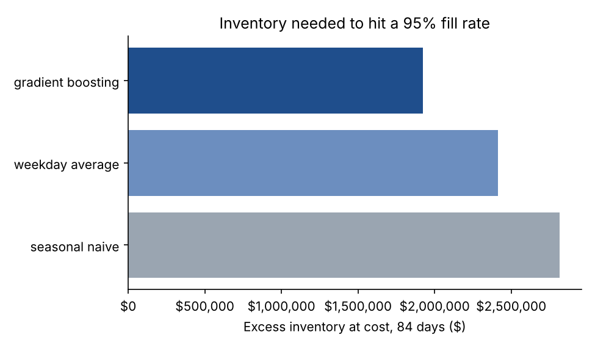
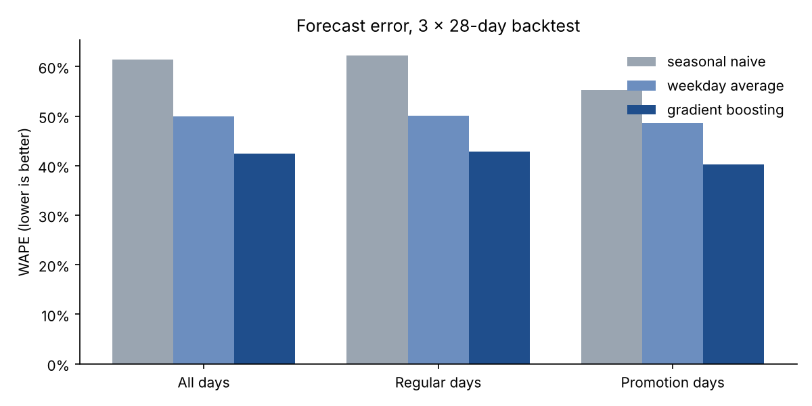
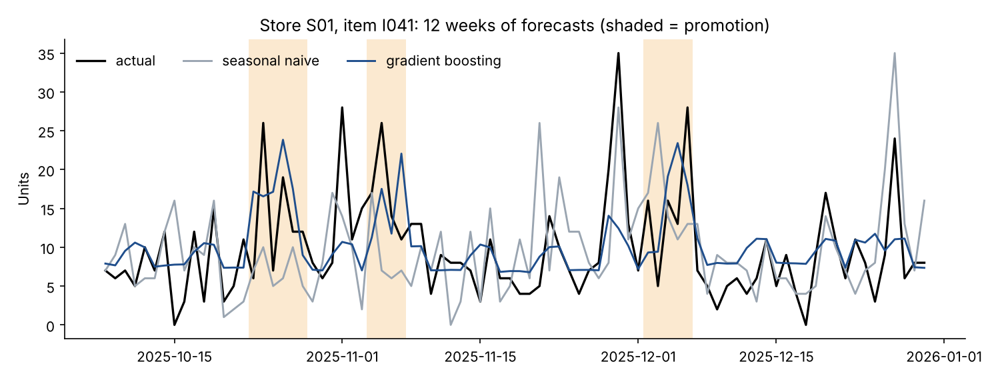

# Retail Demand Forecasting: Better Forecasts, Less Inventory

Forecasting daily unit sales for 500 store-item combinations, four weeks ahead, and translating forecast accuracy into the number a retail operations leader actually cares about: **how much inventory it takes to keep shelves stocked.**

  

> **Data note:** all sales data is synthetic, produced by [`data/generate_data.py`](data/generate_data.py): 10 stores × 50 items × 2 years of daily sales (365,000 rows). The simulator includes weekly and annual seasonality, item trends, store size effects, promotions with price elasticity, holiday spikes and noisy, low-volume items.

---

## The business problem

Retailers order inventory weeks ahead. Forecast too high and cash sits on shelves as overstock and markdowns. Forecast too low and customers find empty shelves. Planners cover forecast error with safety stock, so **every point of forecast error is paid for in inventory**.

The question for this project: how much inventory could a better forecast free up while keeping the same service level?

## Results at a glance

| | Seasonal naive | Weekday average | **Gradient boosting** |
|---|---|---|---|
| WAPE (lower is better) | 61.4% | 49.9% | **42.5%** |
| Bias | +4.5% | +5.7% | **−0.1%** |
| WAPE on promotion days | 55.3% | 48.5% | **40.2%** |
| Excess inventory to hit a 95% fill rate (84 days, at cost) | $2.82M | $2.42M | **$1.92M** |

- **15% lower forecast error** than the best baseline across a 3-fold, 84-day rolling backtest.
- **20% less excess inventory** (about $490K at cost over 12 weeks across 10 stores) at the **same 95% fill rate**.
- **Essentially unbiased.** The baselines over-forecast by about 5%, which builds up as overstock.



## Approach

### 1. Forecast design: direct 28-day horizon
Every lag and rolling feature is shifted by at least 28 days, so a single model can forecast any day in the next four weeks using only data available on the day the forecast is made. That rules out data leakage by design (there's a unit test for it) and avoids the error build-up of recursive forecasting.

Features fall into three groups:
- **Demand history:** lags at 28, 35, 42 and 364 days; rolling 7/28/91-day means; 28-day volatility; and the same-weekday average.
- **Known in advance:** day of week, week and month, holidays, planned promotions, price and discount depth.
- **Series identity:** store, item and category, handled natively as categorical features.

### 2. Models
| Model | What it does |
|---|---|
| **Seasonal naive** | Uses the same weekday four weeks ago, the most recent value available at a 28-day horizon. |
| **Weekday average** | Averages the same weekday over the prior four weeks. This is a strong, common production baseline. |
| **Global gradient boosting** | One `HistGradientBoostingRegressor` with Poisson loss, trained across all 500 series. |

A **global model** learns shared patterns (promotion response, holiday effects, weekday shape) across every series. Slow-moving items benefit the most, because each one has too little history to learn from alone. **Poisson loss** matches count data and keeps forecasts non-negative.

### 3. Backtesting
The models are evaluated with three rolling origins, each training on all history before the cutoff and forecasting the next 28 days. The final fold covers the holiday season, the hardest stretch of the year.

| Fold | Forecast window | Seasonal naive | Weekday avg | Gradient boosting |
|---|---|---|---|---|
| 1 | Oct 8 – Nov 4 | 59.9% | 49.0% | **41.5%** |
| 2 | Nov 5 – Dec 2 | 60.5% | 49.0% | **41.3%** |
| 3 | Dec 3 – Dec 30 | 64.2% | 51.9% | **44.9%** |

The improvement holds in every fold and every product category ([table](reports/tables/wape_by_category.csv)).



The gap is widest on promotion days. The baselines can't see a planned promotion coming, but the model uses discount depth as an input:



### 4. From accuracy to inventory
Accuracy metrics don't mean much to a merchant. Inventory dollars do. For each model, the [simulation](src/forecasting/evaluate.py) sets daily stock at:

```
stock = forecast + z × recent demand volatility
```

and then searches for the smallest safety multiplier `z` that reaches a **95% fill rate** across all 42,000 store-item-days in the backtest. Every model gets the same volatility signal and the same service target. The only difference is forecast quality, so the gap in excess inventory is what better forecasting is worth.

### 5. What drives the forecast
The top features by permutation importance are recent demand level (28- and 91-day means), item identity, day of week and discount depth ([table](reports/tables/feature_importance.csv)). In short: recent demand level, weekly rhythm, and promotions.

## Repository structure

```
├── data/generate_data.py          # synthetic store-item sales simulator
├── src/forecasting/
│   ├── features.py                # leakage-safe 28-day-horizon features
│   ├── models.py                  # baselines + global gradient boosting
│   ├── evaluate.py                # WAPE, bias, fill rate, safety-stock search
│   └── pipeline.py                # rolling-origin backtest, tables, figures
├── reports/                       # metrics.json, figures/, tables/
├── tests/                         # leakage, metric and simulation tests
└── Makefile
```

## Run it yourself

```bash
git clone https://github.com/chatnic/retail-demand-forecasting.git
cd retail-demand-forecasting
python -m venv .venv && source .venv/bin/activate
make setup
make all      # generate data -> backtest -> tests (~1 minute)
```

## What I'd do next in a real engagement

- **Forecast distributions, not just point forecasts.** Quantile models give each item's safety stock its own appropriate distribution.
- **Account for stockouts.** Recorded sales on a stockout day understate true demand, so those days need to be adjusted before training.
- **Forecast hierarchically and reconcile.** Item × store → item × region → category, so forecasts match up for merchants and planners.
- **Feed in the promotion calendar.** Pull future promotions straight from the merchandising system, and report forecast value added by planner overrides.

## License

MIT. See [LICENSE](LICENSE).
